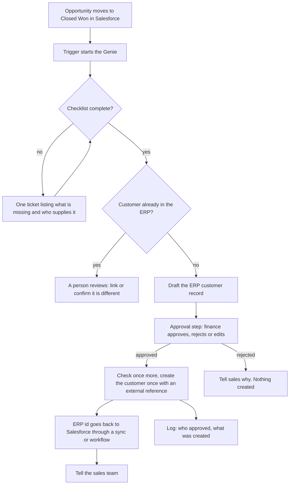

# Architecture: from Closed Won to a customer in the ERP

## The parts

| Part | What it is | In this repo |
|---|---|---|
| **Trigger** | Starts the Genie when the stage becomes Closed Won | [trigger design](trigger-design.md) |
| **Rules** | The checklist and the customer match | [`code/validator.py`](../code/validator.py), [`code/customer_match.py`](../code/customer_match.py) |
| **Genie** | Reads context, runs the steps, writes the request, explains | [`genie/job-description.md`](../genie/job-description.md), [`genie/master-prompt.md`](../genie/master-prompt.md) |
| **Ticket** | The request for missing details | [ticket design](ticket-design.md) |
| **Approval** | A person decides before the create | [approval design](approval-design.md) |
| **ERP write** | One customer, with an external reference | [`code/pipeline.py`](../code/pipeline.py) |
| **Write-back** | The ERP id returns to the CRM, by sync or workflow | [notes](salesforce-netsuite-notes.md) |
| **Log** | Every run and decision | The log explorer |

## Genie or workflow?

| Part | Best as |
|---|---|
| Validate the checklist | Rules (a workflow or code) |
| Match existing customers | Rules, with the agent explaining |
| Write the ticket text, summarize, explain | The Genie |
| Create the customer | The Genie's skill, with approval |
| Write the id back to the CRM | A sync or a workflow |

A workflow runs the same steps each time. A Genie decides which actions to take. Use each for what it is good at. If you can describe every step in advance, a workflow is simpler and cheaper. The Genie earns its place where the context is messy (notes, emails, contract text) and the output is a clear, human-readable request.

## A simpler variant, and a bigger one

- **Simpler:** a workflow that checks the checklist, opens the ticket and creates an approval task. No AI. Same approvals, same logs. It runs without Copilot or Genies.
- **Bigger:** add Slack as the place where finance approves, add a scheduled Genie task that reminds owners about stale tickets, add provisioning steps after the customer exists.

## What the agent never touches

Existing customers, credit, payment terms, tax settings, and anything in Salesforce. See [rollout and risks](rollout-and-risks.md).

Product pages: [Stacksync AI agents](https://www.stacksync.com/ai-agents) · [workflow automation](https://www.stacksync.com/workflow-automation).
