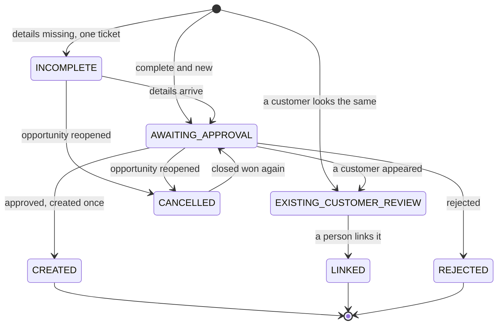

# State and idempotency: the same event twice changes nothing

The hardest part of onboarding automation is not the happy path. It is the **second event**.

## The states

## What each event does in each state

| Event | New | INCOMPLETE | AWAITING_APPROVAL | CREATED, LINKED, REJECTED, EXISTING_REVIEW |
|---|---|---|---|---|
| Closed Won again | Start | Re-validate. Update the ticket, never a second one | Refresh the draft if it changed. Otherwise ignore | Ignore |
| Details complete | | Close the ticket, move on | | |
| Approved | | Not allowed | Create once | Not allowed |
| Rejected | | Not allowed | Stop | |
| Reopened | Ignore | Cancel | Cancel the request | **Never delete anything that was created** |

## Where to keep the state

The agent needs to remember what it did for each opportunity. Options:

| Option | Notes |
|---|---|
| A status field on the opportunity | Visible to sales. Must be written by a sync or workflow, because the agent has no CRM write access |
| A small state table in a database | Easy to query and audit. Good if you already have a synced database |
| The help desk ticket and the ERP external reference | Natural markers: "a ticket is open", "a customer with this external id exists" |

Use the **markers that already exist** as much as you can. A customer with the external reference `opp-...` is proof the create happened, whatever any state field says.

## Idempotency checklist

- [ ] **One ticket** per opportunity. Look first, then create.
- [ ] **One approval request** per draft. Refresh it if the draft changes.
- [ ] **One create** per opportunity, through an external reference.
- [ ] **One notification** after the create.
- [ ] **One write-back** of the ERP id, done by a sync or workflow.
- [ ] A **reopened** opportunity cancels pending work and deletes nothing.
- [ ] Every step is **logged**.

## Retries

If a step fails halfway (the customer was created but the write-back failed), a retry must not create a second customer. The external reference makes the create safe to repeat. The write-back is a plain update, safe to repeat.

All of it is in [`code/pipeline.py`](../code/pipeline.py) and tested in [`code/tests`](../code/tests).
